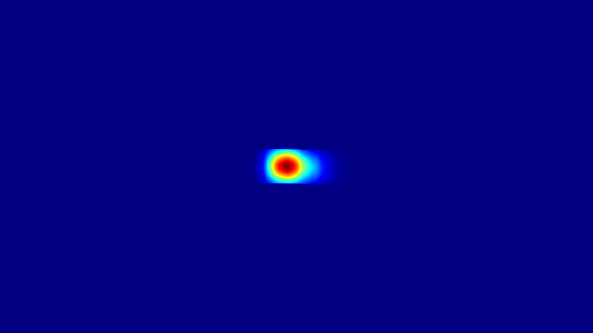

# Webcam-Based Gaze Estimation and Visualisation

This repository contains a real-time gaze estimation system that runs on an ordinary webcam. It locates the irises using MediaPipe Face Mesh, describes the position of each iris within its eye opening through a small set of geometric ratios, and maps these ratios to screen coordinates by means of a short calibration performed at the start of each session. The estimated gaze points are accumulated into a temporally decaying density map, giving an immediate visual impression of where the user has been looking.

The work should be read as a calibrated geometric baseline. No gaze-specific network is trained here; the only learned component is the landmark detector supplied by MediaPipe. This choice keeps the system small, transparent and runnable on a CPU, at the cost of the robustness that appearance-based methods trained on large datasets can offer.

## 1. Background

Gaze estimation methods are commonly divided into model-based approaches, which infer gaze from the geometry of the eye, and appearance-based approaches, which regress gaze directly from eye images (Hansen and Ji, 2010). Appearance-based convolutional models trained on datasets such as MPIIGaze (Zhang et al., 2015) generalise well across users, but they require substantial training data and careful handling of head pose. For low-cost interactive use, a common alternative is to obtain iris landmarks from a pretrained face model and learn a user-specific mapping to the screen through calibration, an approach that has been explored in recent work on webcam-based interaction (Chhimpa et al., 2024). The present system follows this second line.

## 2. Method

### 2.1 Landmark detection

Each frame is horizontally mirrored and passed to MediaPipe Face Mesh (Kartynnik et al., 2019) with `refine_landmarks=True`. In this mode the model returns 478 landmarks, of which indices 468 to 472 describe the left iris and 473 to 477 the right iris (Ablavatski et al., 2020). The iris centres are taken as landmarks 468 and 473.

### 2.2 Geometric feature formulation

For each eye, let **o** and **i** denote the outer and inner eye corners, **t** and **b** the upper and lower eyelid points, and **p** the iris centre, all in pixel coordinates. The horizontal and vertical ratios are obtained by projecting the iris centre onto the corresponding eye axis:

```text
r_h = ((p - o) · (i - o)) / ||i - o||²
r_v = ((p - t) · (b - t)) / ||b - t||²
```

A value near 0.5 indicates a centred iris, while values toward 0 or 1 indicate displacement toward one edge of the eye opening. Because both ratios are normalised by the size of the eye itself, they are largely insensitive to the distance between the face and the camera and to the position of the face in the image. Combining both eyes gives the four-dimensional feature vector

```text
f = [r_h(left), r_v(left), r_h(right), r_v(right)]
```

The landmark indices used are listed below.

| Region | Left eye | Right eye |
|---|---|---|
| Eye corners (outer, inner) | 33, 133 | 362, 263 |
| Eyelids (upper, lower) | 159, 145 | 386, 374 |
| Iris centre | 468 | 473 |

### 2.3 Blink rejection

Frames recorded during a blink yield unreliable iris positions. An openness score, defined as the ratio of vertical eyelid separation to horizontal eye width in the manner of the eye aspect ratio (Soukupová and Čech, 2016), is computed for each frame, and frames scoring below 0.15 are discarded.

### 2.4 Per-session calibration

Nine targets arranged in a 3 × 3 grid are displayed in turn, inset from the screen border by 8 % of its width and height. The user fixates each target and presses the space bar, at which point the current feature vector is paired with the known target coordinates. Two independent regressors, one for each screen axis, are then fitted:

```text
x̂ = g_x(φ(f)),   ŷ = g_y(φ(f))
```

where φ is a second-degree polynomial expansion and g is ridge regression (Hoerl and Kennard, 1970) with α = 1.0. The degree-two expansion of a four-dimensional input produces 15 terms, which exceeds the nine calibration samples. Ordinary least squares would therefore be underdetermined, and the ridge penalty is what makes the fit well posed. The fitted model is serialised to `calibration_model.pkl` and reloaded automatically in later sessions.

### 2.5 Gaze density visualisation

Every predicted point is clipped to the 1280 × 720 virtual screen and added to an accumulator as an isotropic Gaussian with σ = 25 px. To avoid recomputing a full-frame Gaussian per point, a 75 × 75 kernel is computed once and stamped at each location, with clipping at the canvas boundary. After every frame the accumulator is multiplied by a decay factor of 0.985. This corresponds to a half-life of roughly 46 frames, or about 3.3 s at the frame rate observed in the recorded session, so that older fixations fade while recent ones remain visible. The normalised map is rendered with the JET colour map and blended over the canvas only where the signal exceeds a small threshold.

## 3. Installation

Python 3.10 or 3.11 is recommended. MediaPipe is pinned to version 0.10.21 because the program relies on the legacy `mp.solutions.face_mesh` interface.

```bash
git clone <repository-url>
cd "Gaze Estimation & Visualization"
python -m venv venv
```

Activate the environment with `.\venv\Scripts\activate` on Windows or `source venv/bin/activate` on Linux and macOS, then install the dependencies and run the program:

```bash
pip install -r requirements.txt
python main.py
```

## 4. Usage

On first launch the system is uncalibrated. Press `c` to begin calibration, fixate each green target, and press `SPACE` to record it. Once all nine points are captured, live estimation begins.

| Key | Action |
|---|---|
| `c` | Start or repeat calibration |
| `SPACE` | Capture the current calibration target |
| `ESC` | Cancel calibration |
| `h` | Show or hide the heatmap |
| `s` | Save a heatmap snapshot |
| `q` | Quit and save session outputs |

A session produces three files: `gaze_log.csv`, containing a Unix timestamp and estimated screen coordinates for each valid frame; `calibration_model.pkl`, holding the fitted calibration model; and `session_heatmap.png`, the final density map.

## 5. Repository structure

| File | Role |
|---|---|
| `main.py` | Capture loop, calibration procedure, prediction, logging and keyboard control |
| `utils.py` | Landmark indices, feature extraction and eye-openness score |
| `calibration.py` | Target layout and polynomial ridge calibration model |
| `heatmap.py` | Gaussian accumulation, temporal decay, rendering and export |
| `requirements.txt` | Python dependencies |

## 6. Recorded session

The included log was recorded in a single session of approximately 50 s and contains 697 gaze samples, an effective rate of about 14 Hz. The mean estimated gaze position was (642, 361) px, close to the centre of the 1280 × 720 screen.



The spread of the estimates differs markedly between the two axes. Horizontal estimates range from about 457 to 869 px, whereas vertical estimates stay within roughly 349 to 369 px. A vertical range of only 20 px is too narrow to reflect natural viewing, and it points to a known weakness of iris-based features: vertical iris movement is small relative to the eye opening and is partly hidden by the eyelids, so the vertical ratio carries much less signal than the horizontal one. In practice the current system resolves horizontal gaze far better than vertical gaze.

These figures describe one session only. They are not a measure of accuracy, since no independent ground-truth fixations were recorded.

## 7. Evaluation protocol

A proper accuracy assessment would present a set of validation targets that are distinct from the calibration targets, record the predicted gaze while each is fixated, and compute the Euclidean error

```text
e = sqrt((x̂ - x)² + (ŷ - y)²)
```

for every sample. The mean and median of this error, its value per target, and the error measured separately along each axis would together give a fair picture of performance. Reporting the per-axis error is particularly important here, given the vertical compression noted in Section 6. Converting pixel error to degrees of visual angle would further require the viewing distance and the physical size of the screen.

## 8. Limitations

The system does not model head pose, so moving the head after calibration shifts the eye corners relative to the camera and degrades accuracy. The calibration is tied to one user, one camera position and one set of lighting conditions, and must be repeated when any of these change. Only a single sample is captured per calibration target, which leaves the fit sensitive to momentary noise. The blink filter currently uses the left eye only. Image quality also matters: dim lighting, strong shadows, low webcam resolution and reflections from spectacles all reduce the reliability of the iris landmarks. Finally, although the gaze mapping itself is a simple regression, the pipeline as a whole depends on a learned landmark model and should not be described as free of machine learning.

The system is suited to estimating the coarse screen region a person is attending to. It is not a substitute for clinical or research-grade eye tracking.

## 9. Future work

Several extensions follow naturally. Head-pose estimation from the full face mesh could be added as an input to the calibration model. Averaging several frames per calibration target, and adding a validation stage after calibration, would make the fit more stable and allow its quality to be reported automatically. Temporal smoothing of the output, for instance with a Kalman or One Euro filter, would reduce jitter, and fixation and saccade detection would make the logs more useful for analysis. A comparison against an appearance-based model trained on MPIIGaze or GazeCapture would place the baseline in context.

## References

Ablavatski, A., Vakunov, A., Grishchenko, I., Raveendran, K. and Zhdanovich, M. (2020). Real-time pupil tracking from monocular video for digital puppetry. *arXiv preprint* arXiv:2006.11341.

Chhimpa, G. R., Kumar, A., Garhwal, S. et al. (2024). Revolutionizing gaze-based human–computer interaction using iris tracking: A webcam-based low-cost approach with calibration, regression and real-time re-calibration. *IEEE Access*.

Hansen, D. W. and Ji, Q. (2010). In the eye of the beholder: A survey of models for eyes and gaze. *IEEE Transactions on Pattern Analysis and Machine Intelligence*, 32(3), 478–500.

Hoerl, A. E. and Kennard, R. W. (1970). Ridge regression: Biased estimation for nonorthogonal problems. *Technometrics*, 12(1), 55–67.

Kartynnik, Y., Ablavatski, A., Grishchenko, I. and Grundmann, M. (2019). Real-time facial surface geometry from monocular video on mobile GPUs. *CVPR Workshop on Computer Vision for Augmented and Virtual Reality*.

Soukupová, T. and Čech, J. (2016). Real-time eye blink detection using facial landmarks. *21st Computer Vision Winter Workshop*.

Zhang, X., Sugano, Y., Fritz, M. and Bulling, A. (2015). Appearance-based gaze estimation in the wild. *Proceedings of the IEEE Conference on Computer Vision and Pattern Recognition*, 4511–4520.

## License

Released under the MIT License.